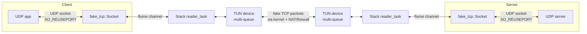

# Repository Guidelines

## Project Overview

Phantun is a lightweight, fast UDP-to-TCP obfuscator written in Rust (the only `unsafe` code is the macOS `utun` FFI in `fake-tcp/src/darwin/`). It converts UDP datagrams into fake TCP segments that pass through stateful L3/L4 firewalls and NAT devices — useful where UDP is blocked or throttled but TCP is allowed. The defining design decision: the TCP stack implements **only** enough TCP to satisfy stateful inspection (3-way handshake, per-packet SEQ/ACK, RST on close). There is deliberately **no retransmission, no flow control, and no congestion control**, so datagram semantics (including out-of-order delivery) are fully preserved. It will not pass through L7 proxies.

Cargo workspace with two crates, both edition 2024:

- **`fake-tcp`** (v0.7.1, library) — TUN-based userspace async TCP stack for packet-oriented tunneling.
- **`phantun`** (v0.8.1, binaries) — the `phantun_client` and `phantun_server` CLI tools built on `fake-tcp`.

## Architecture & Data Flow



- Both binaries create a **multi-queue TUN device** (one fd per core, `TunBuilder::queues(num_cpus)`) and a `fake_tcp::Stack` over it. One `reader_task` per TUN queue parses incoming IP/TCP packets and dispatches by `(local_addr, remote_addr)` tuple through per-connection `flume` channels, with a per-core local cache for lock-free dispatch on the hot path.
- **Client** (`phantun/src/bin/client.rs`): binds a `SO_REUSEPORT` UDP listener with `IP_PKTINFO`; first datagram from a peer triggers `stack.connect(remote)` (SYN handshake), then spawns `num_cpus` fastpath tasks bridging UDP recv ↔ `sock.send()` and `sock.recv()` ↔ UDP send via `tokio::select!`.
- **Server** (`phantun/src/bin/server.rs`): `stack.listen(port)` + `stack.accept().await` loop; each accepted connection spawns the same per-core fastpath workers toward the UDP `--remote`.
- **Handshake emulation**: client `connect()` sends SYN (always seq=0), waits SYN+ACK, sends ACK; server `accept()` mirrors it. `TIMEOUT = 1s`, `RETRIES = 6` govern the handshake only. Server-side `reader_task` rejects SYNs with `sequence != 0` as a cheap discriminator against real TCP traffic.
- **Teardown**: `Socket::drop` removes the tuple and sends RST (abortive close — no FIN handshake).
- **Idle timeout**: connections idle for `UDP_TTL = 180s` (`phantun/src/lib.rs`) are torn down via `CancellationToken` + `Notify` heartbeat.

### Non-obvious invariants (editor traps)

- `MAX_PACKET_LEN = 1500` (`fake-tcp/src/packet.rs`) is a buffer size, **not** MSS enforcement. No fragmentation, no MSS clamping; DF bit always set. Datagram size is the caller's responsibility.
- After `State::Established`, lost packets stay lost — `seq` just `fetch_add`s. Do not "fix" this; reliability is out of scope by design.
- TCP window is hardcoded `0xffff`; the idle-ACK heuristic (`MAX_UNACKED_LEN = 128MB`) is a keepalive, not flow control.
- All checksums (IPv4 header + TCP pseudo-header, v4 and v6) are computed in software by `ones_sum`/`fold_checksum` in `fake-tcp/src/packet.rs` (SWAR 16-bit lanes in `u64`, folded once); there is no hardware offload to toggle. `build_tcp_packet_into` writes headers on the stack and appends header+payload once — keep it allocation- and memset-free.
- **Client/server worker-socket asymmetry is intentional**: both sides create a per-worker socket via `new_udp_reuseport` + `connect`, but the *bind address* differs. Client workers bind to the PKTINFO-derived destination IP of the peer's first datagram (`client.rs:238-258`) — replying from the exact address the peer used avoids IPv6 privacy-extension misbinding (comment at `client.rs:231-237`). Server workers all bind a shared ephemeral port discovered via a temporary bind (`server.rs:191-198`), then connect to the fixed `--remote`. Do not "unify" these — the client's per-peer bind is load-bearing for IPv6 correctness.
- IPv6 TUN addressing is done via `neli` netlink (`assign_ipv6_address` in `phantun/src/utils.rs`) because `tokio-tun` only configures IPv4. Removing it breaks IPv6 silently.
- **macOS (`cfg(target_os = "macos")`)**: `tokio-tun`/`neli` are replaced by `fake_tcp::darwin::{Tun, TunBuilder}` (utun kernel-control socket, 4-byte big-endian AF header stripped/added via `readv`/`writev`, addresses set with `/sbin/ifconfig`, IPv6 configured by the builder). utun is single-queue, and macOS rejects a second socket `connect`ed to the same 4-tuple (`EADDRINUSE`) and doesn't load-balance `SO_REUSEPORT`, so `new_udp_worker_sockets` returns **one** socket per connection there (N on Linux). IPv4 destination address comes from `IP_RECVDSTADDR` (no `IP_PKTINFO`). `utun` control sockets never signal write readiness, so `Tun::send` retries `ENOBUFS`/`EAGAIN` with a 500µs sleep instead of awaiting `writable()`.

## Key Directories

| Path | Purpose |
|---|---|
| `fake-tcp/src/` | Userspace TCP stack: `lib.rs` (`Stack`, `Socket`, `State`, dispatch, handshake), `packet.rs` (`build_tcp_packet`, `parse_ip_packet`, checksums), `darwin/` (macOS utun `Tun`/`TunBuilder`) |
| `phantun/src/bin/` | Binary entry points: `client.rs`, `server.rs` |
| `phantun/src/` | `lib.rs` (exports `utils`, `UDP_TTL`), `utils.rs` (SO_REUSEPORT sockets, per-connection worker sockets, PKTINFO recvmsg, netlink IPv6) |
| `.github/workflows/` | CI: `rust.yml` (clippy+build on Linux and macOS), `release.yml` (cross-compile Linux releases + native macOS builds), `docker.yml` (image build) |
| `docker/` | `Dockerfile`, `docker-compose.yml` (manual test rig), `phantun.sh` (entrypoint: sysctl + iptables/nftables NAT auto-config) |
| `debian/`, `rpm/`, `selinux/` | Packaging: debhelper cargo buildsystem, RPM spec (note: spec version lags Cargo.toml), SELinux module extending the `wireguard_t` domain |

## Development Commands

```bash
cargo clippy --verbose     # lint — the CI gate (rust.yml); no fmt check, no test step
cargo build --verbose      # debug build (as CI does)
cargo build --release      # produces target/release/{client,server} → released as phantun_client/phantun_server

# Cross-compile release targets (10 stable targets via cross; 3 MIPS targets need nightly + rust-src + -Z build-std)
cross build --release --target x86_64-unknown-linux-musl
cargo +nightly build --release --target mips-unknown-linux-musl -Z build-std

# Nightly-only packet benchmarks (fake-tcp, feature-gated)
cargo +nightly bench -p fake-tcp --features benchmark

# Manual end-to-end rig (privileged, host networking, auto-NAT)
docker build -t phantun -f docker/Dockerfile .
docker compose -f docker/docker-compose.yml up

# Packaging
make -C selinux            # SELinux policy module
dpkg-buildpackage -us -uc  # Debian
rpmbuild -ba rpm/phantun.spec
```

Releases are tag-driven: pushing a `v*.*.*` tag runs `release.yml`, which cross-compiles all targets and uploads zipped `phantun_client` + `phantun_server` binaries to GitHub Releases (tag containing `-` → prerelease). Nothing is published to crates.io by CI.

## Code Conventions & Common Patterns

- **Error handling**: `main` returns `io::Result<()>` with `?` propagation; setup code uses `.unwrap()`/`.expect("descriptive message")` for infallible-by-design operations; hot paths use `Option` sentinels (`sock.send()`/`sock.recv()` return `None` when the connection dies). No `anyhow`/`thiserror`/custom error types anywhere.
- **Async**: `#[tokio::main]` multi-threaded runtime; scaling via `num_cpus::get()` driving TUN queue count, reader tasks, and per-connection worker count. Shared state: `Arc` + `std::sync::RwLock` (global tuple map), `flume::bounded(512)` per-socket queues, `tokio::sync::mpsc` (accept queue), `broadcast` (tuple purge), `AtomicU32` with `Relaxed` ordering for seq/ack, `CancellationToken` for shutdown.
- **Zero allocation on the hot path**: per-worker 1500-byte stack buffers; packets built into `BytesMut::zeroed()`.
- **Logging**: `log` facade + `pretty_env_logger` (env `RUST_LOG`; Docker defaults to `INFO`). `info!` for lifecycle, `debug!` for connection table changes, `trace!` for cache hits, `error!`/`warn!` for failures.
- **CLI**: clap **builder** pattern exclusively (`Command::new`, `Arg::new`, `ArgAction::SetTrue`, `.conflicts_with_all()`, `crate_version!()`).
- **Naming**: `CamelCase` types, `snake_case` fns, `SCREAMING_SNAKE_CASE` consts, buffer vars like `buf_udp`/`buf_tcp`.
- **Style**: edition 2024 idioms (let-chains, e.g. `if size > 0 && let Err(e) = ...`). `fake-tcp/src/lib.rs` has thorough crate-level rustdoc — match it when touching that crate.

### Running client/server (operational context matters)

Both binaries require `CAP_NET_ADMIN` (root, or `sudo setcap cap_net_admin=+pe <binary>`) and kernel IP forwarding. The client side needs SNAT/MASQUERADE from the TUN interface; the server side needs DNAT from the listen port to the TUN peer — see README "Usage" or let `docker/phantun.sh` apply rules automatically.

```bash
# Server: listen on TCP 4567, forward to UDP 127.0.0.1:1234
RUST_LOG=info ./target/release/server --local 4567 --remote 127.0.0.1:1234
# Client: listen on UDP 127.0.0.1:1234, connect to server
RUST_LOG=info ./target/release/client --local 127.0.0.1:1234 --remote 10.0.0.1:4567
```

Key flags (`-l/--local`, `-r/--remote` required on both): `--tun`, `--tun-local`, `--tun-peer`, `--tun-local6`, `--tun-peer6`, `-4/--ipv4-only`, `--handshake-packet <file>`. Defaults: client TUN `192.168.200.1/.2` + `fcc8::1/::2`; server `192.168.201.1/.2` + `fcc9::1/::2`. Note the asymmetry: server `--local` is a bare PORT, client `--local` is IP:PORT.

## Important Files

| File | Role |
|---|---|
| `Cargo.toml` (root) | Workspace: `resolver = "3"`, members `fake-tcp` + `phantun`, shared `tokio` (full) + `log` |
| `fake-tcp/src/lib.rs` | `Stack` (TUN I/O, dispatch, `listen`/`accept`/`connect`), `Socket` (per-connection `send`/`recv`), handshake state machine |
| `fake-tcp/src/packet.rs` | IP+TCP packet build/parse, software checksums, `MAX_PACKET_LEN`, nightly benchmarks |
| `phantun/src/bin/client.rs` / `server.rs` | Binary entry points, per-core fastpath, 180s idle reaper |
| `phantun/src/utils.rs` | `new_udp_reuseport`, `new_udp_worker_sockets`, `udp_recv_pktinfo`, `assign_ipv6_address` (netlink, Linux only) |
| `fake-tcp/src/darwin/tun.rs` | macOS utun device + builder |
| `.github/workflows/rust.yml` | CI gate: clippy + build on stable, `ubuntu-latest` and `macos-latest` |
| `docker/phantun.sh` | Reference for required sysctl/iptables setup |

## Runtime/Tooling Preferences

- **Rust stable ≥ 1.85** required (edition 2024 + workspace resolver 3). No `rust-toolchain` file; CI uses unpinned `stable`. Nightly only for MIPS cross-builds and benchmarks.
- **Platforms**: Linux (TUN devices, `SO_REUSEPORT` load balancing, `IP_PKTINFO`, netlink) and macOS (`utun`, `IP_RECVDSTADDR`, `ifconfig`). Other OSes don't build.
- **Runtime privileges**: Linux: `CAP_NET_ADMIN` + the `tun` kernel module; `net.ipv4.ip_forward=1` (and IPv6 forwarding) required. macOS: root; `net.inet.ip.forwarding=1` (and `net.inet6.ip6.forwarding=1`), NAT via `pf` (README "macOS").
- **Protocol compatibility**: client and server should run the **same minor version** — no version negotiation exists (README policy).
- **MTU**: Phantun adds 12 bytes of overhead vs plain UDP (40-byte IP+TCP vs 28-byte IP+UDP header). E.g. WireGuard over Phantun on a 1500 link: MTU 1428 (IPv4) / 1408 (IPv6). DF is always set — oversized datagrams die silently.

## Testing & QA

- **There are no unit or integration tests** — no `#[test]`, no `tests/` dirs; "integration tests" is an explicit README future-plan item. CI runs `cargo clippy` + `cargo build` only.
- The only test-adjacent code: three `#[bench]` functions in `fake-tcp/src/packet.rs` behind `#[cfg(all(test, feature = "benchmark"))]`, requiring nightly (`cargo +nightly bench -p fake-tcp --features benchmark`).
- **Verification is manual and packet-level**: use the `docker/docker-compose.yml` rig (privileged host-mode client+server pair), the README usage checklist, and `tcpdump` on the Phantun port (the bug-report template asks for exactly that). On macOS a single-host rig works without NAT: run server and client with distinct `--tun-local`/`--tun-peer` subnets, point the client's `--remote` at the server's tun peer address, enable `net.inet.ip.forwarding`, and echo UDP through it. Stale `utun` interfaces holding the same addresses capture the routes and make the handshake time out.
- Practical bar for changes: `cargo clippy` clean, `cargo build --release` succeeds, plus a manual end-to-end run for anything touching the data path, handshake, or NAT interaction.
